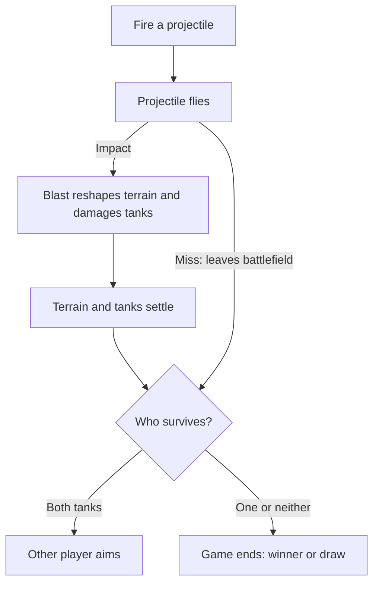

# A shot, from firing to the next turn

Use this map to understand what happens after a player fires, before exploring
how the game implements it. The main downward path follows a shot that hits.

- **Fire and flight:** The projectile travels until it hits something or leaves
  the battlefield. A miss skips the blast and settling stages and completes the
  turn immediately.
- **Blast and settling:** An impact carves the terrain and applies blast damage
  before terrain and tanks settle. Either tank can be destroyed, including the
  shooter; falling can also damage tanks.
- **Turn outcome:** After settling (or a miss), both tanks surviving means the
  other player can aim. One survivor wins; no survivors means a draw.

This is the normal gameplay lifecycle, not a recovery guide. If settling fails,
play stops and a new match is required rather than advancing the turn.

For implementation ownership, ordering, timing and failure handling, see the
[TASK10 technical shot-resolution flow](shot-resolution.md).
