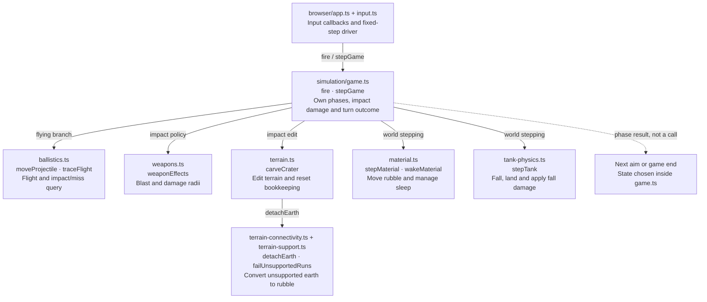

# Shot lifecycle: modules and APIs

Use this map to find **where to change shot behavior**, starting from the
[TASK11 conceptual lifecycle](shot-conceptual.md). For exact execution order,
thresholds and the wider contract inventory, use the
[TASK10 technical flow](shot-resolution.md). This page groups responsibilities,
not every function in the call chain.

## Module & API map

**Legend:** solid arrows are direct calls made within the grouped source modules;
labels identify their context, not calls from every API in a box. The dotted arrow
is a state transition, not a function call. Browser callbacks call the game APIs;
registration and browser scheduling are not drawn as application calls. All
simulation filenames are under `src/simulation/`.

Flight, impact and settling are coordinated **inside game.ts**: there is no direct
ballistics-to-crater or crater-to-material call. Impact enters `exploding`; later
`stepGame` calls advance settling. A miss skips impact/settling and completes the
turn. World stepping also runs while aiming, but not while flying. Material is
stepped before tanks; tank movement causes game.ts to call `wakeMaterial`.

## API navigation

APIs are exported unless marked **private**. Types and shared state shapes live in
[model.ts](../../../src/simulation/model.ts).

| Conceptual operation | Responsible module (source) | Principal API / implementation | Responsibility |
| --- | --- | --- | --- |
| Accept fire and drive time | [browser/app.ts](../../../src/browser/app.ts), [browser/input.ts](../../../src/browser/input.ts) | `startGame`, `bindArcadeInput` | Register firing callbacks and drive simulation at 1/120-second steps. |
| Fire | [game.ts](../../../src/simulation/game.ts) | `fire` | Snapshot launch state and selected weapon into a projectile and enter flying. |
| Projectile flies; classify impact or miss | [ballistics.ts](../../../src/simulation/ballistics.ts) | `moveProjectile`, `traceFlight` | Integrate a candidate position and query the swept path without mutating the game. |
| Blast policy and tank damage | [game.ts](../../../src/simulation/game.ts), [weapons.ts](../../../src/simulation/weapons.ts) | **private** `explode`; exported `weaponEffects` | Capture weapon effects, initiate the crater and damage both tanks before falling. |
| Reshape terrain | [terrain.ts](../../../src/simulation/terrain.ts) | `carveCrater` | Remove cells, restore bottom anchors, relax support and invalidate/reset terrain bookkeeping. |
| Detach unsupported earth | [terrain-connectivity.ts](../../../src/simulation/terrain-connectivity.ts), [terrain-support.ts](../../../src/simulation/terrain-support.ts) | `detachEarth`, `failUnsupportedRuns` | Repeatedly convert unsupported earth into rubble until support relaxation stops changing earth. |
| Terrain settles | [material.ts](../../../src/simulation/material.ts) | `stepMaterial`, `wakeMaterial` | Advance rubble around tank obstacles and restart sleeping deposits after disturbances. |
| Tanks settle | [tank-physics.ts](../../../src/simulation/tank-physics.ts) | `stepTank` | Apply swept falling and landing damage, including updates to dead tanks. |
| Decide survivors and next turn | [game.ts](../../../src/simulation/game.ts) | `stepGame`; **private** `advanceResolution`, `finishShot` | Wait for stability, then alternate the player or record a winner/draw. |

For example, change crater shape in `terrain.ts`, not in ballistics; change when a
turn ends in `game.ts`, not in the material movement boolean. Gameplay falling
uses `stepTank`; `terrain.ts`'s `settleTank` is spawn-only.

## Contracts that matter across boundaries

**Documentation status:** none of the APIs below has JSDoc. These summaries are
source-observed behavior, not quotations of documented guarantees. Existing
ordinary comments are identified explicitly. Caller obligations inferred from
usage are labeled as such. Numeric coordinates/radii are world pixels and time
arguments are seconds.

### Game entry points and failure ownership

- `fire(game: Game): boolean`: outside aiming, returns `false` without mutation.
  Otherwise creates the projectile, captures weapon and launch velocity, sets the
  phase/status and returns `true`; success means launched, not hit. It assumes a
  valid active tank and does not validate that state or report a structured error.
  Callers should use a valid game and treat `false` as a rejected action.
- `stepGame(game: Game, seconds: number, movement = 0): void`: dispatches the
  current phase, mutating the supplied game and its terrain/tanks. Missing
  projectile in flying or missing explosion in exploding produces no work.
  There is no finite/nonnegative timestep validation. **Inferred caller duty:**
  supply small, finite, nonnegative simulation steps; the browser supplies 1/120 s.
  Resolution exceeding 10 s throws **after** world and clock mutations, before
  checking completion. There is no rollback or success return. An ordinary
  browser comment explicitly says only restart can resume a partially failed
  match; its catch stops simulation until New match replaces the game. A new
  caller must define recovery rather than blindly retrying the same state.

### Flight query boundary

`traceFlight(game: Game, from: Projectile, to: Projectile): FlightResult` is a
read-only query. Its ordinary comment specifies swept sampling at no more than
one world pixel and small fixed caller timesteps. It samples after the start
point through the endpoint; world exit wins over collision at a sample, while
negative Y permits high arcs. The result includes the sampled projectile and
`flying`, `impact` or `miss`; it does not apply impact effects. game.ts owns the
resulting state transition. **Inferred caller duty:** provide coherent segment
endpoints, normally from `moveProjectile`, and handle all outcomes. No explicit
validation/error path exists for invalid numeric endpoints.

### Terrain edit boundary

`carveCrater(terrain: Terrain, impact: Point, radius = BLAST_RADIUS): void` mutates
cells, restores bottom anchors, calls support relaxation, increments `revision`
and resets material time/speed/distance. It returns no change indicator and does
not validate radius or impact coordinates. **Inferred caller duty:** provide
valid world coordinates/radius and let this operation finish before simulation
continues; it owns terrain bookkeeping, not tank damage or game phases.

`detachEarth(terrain: Terrain): void` is exported but lower-level: it relaxes
support and sets `moving` from rubble presence. Its ordinary comment explicitly
assigns revision invalidation and gravity-clock resets to callers. Calling it
instead of `carveCrater` therefore does not reproduce the complete edit contract.
Neither operation provides a structured failure result.

### Settling signals are not generic “changed” flags

- `stepMaterial(terrain: Terrain, tanks: Tank[], seconds: number): boolean`
  mutates cells, terrain revision and shared material clocks; tanks are read as
  obstacles. `true` can mean merely waiting for its internal 1/30-second update,
  not displacement. Sleeping material returns `false` immediately.
- `stepTank(tank: Tank, terrain: Terrain, seconds: number): boolean` mutates tank
  position, velocity, grounding, health and alive state, while reading terrain.
  A supported landing returns `false` even when landing changes health or state;
  falling returns `true`. There is no alive guard.

Neither has an explicit invalid-timestep error path or validates time. **Inferred
caller duty:** use valid mutable state and small finite nonnegative steps. game.ts
uses these booleans together as a *stability signal*, not a mutation report; it
steps material before all tanks and wakes material when tanks move. Changing the
meaning of either return affects the continuous stable interval and hence turn
completion. `wakeMaterial(terrain: Terrain): void` resets the shared gravity clock
only when sleeping rubble exists; its ordinary comment explains why a new
disturbance restarts acceleration. None of these APIs chooses the next player.

## Prioritized documentation gaps

These are focused maintenance risks, not a request for comments on every helper.

1. **Step failure/recovery and timestep contract (`stepGame`):** the browser's
   partial-mutation recovery comment is remote from the exported API. Document
   units, intended caller stepping and non-transactional timeout behavior there
   so another driver does not retry a failed match.
2. **Stability return semantics (`stepMaterial`, `stepTank`):** neither API states
   why waiting can return true or landing mutations can return false. Document
   their consumption by resolution before changing physics or turn timing.
3. **Terrain bookkeeping ownership (`carveCrater`, `detachEarth`):** retain the
   useful lower-level comment, but document the complete edit boundary at
   `carveCrater` so a new edit path does not omit revision/clock maintenance.
4. **Flight query policy (`traceFlight`):** supplement its sampling comment with
   start exclusion, world-exit precedence and caller-owned impact handling when
   changing collision policy; signatures alone do not expose these choices.

## Scope and limitations

The relationships above were checked against current source. Existing TASK10
evidence was reused as structural corroboration, not regenerated. It did not
establish browser callback scheduling or parameter-bound callback targets;
source registration and callback bodies supply that wiring. No main-flow
relationship remains unresolved at this module level, but runtime timing and
exceptional behavior were not independently exercised for this documentation.

This intentionally omits rendering/presentation, detailed support mathematics,
aiming controls and the full private call graph. It is not a correctness audit.
The eight implementation boxes plus one phase-result box keep navigation bounded;
preview readability has not been confirmed with a Mermaid renderer. Recheck linked
source when changing these boundaries or policies.

The three levels answer different questions: TASK11 explains **what happens**,
this map locates **where to edit**, and TASK10 explains **how it executes**. The
navigation table and exported/private distinction are the added value here;
use TASK10 rather than expanding this into another execution graph.
