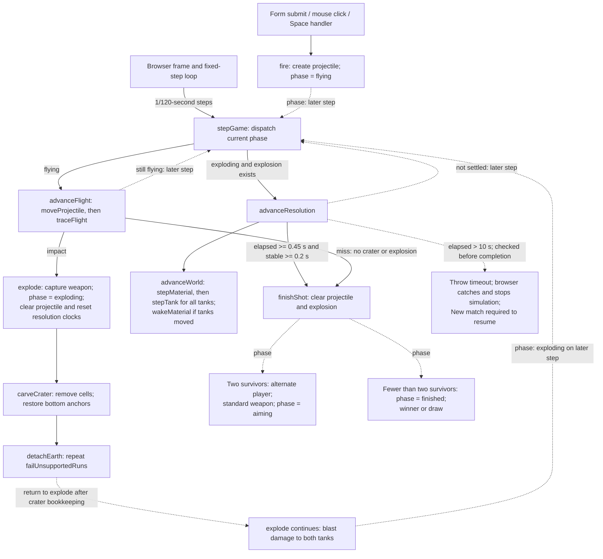

# Shot resolution

Use this map to locate the code responsible for firing, impact, terrain settling,
and turn completion. It preserves the bounded [TASK10 investigation](../../tasks/TASK10-result.md),
with important relationships rechecked against source for its documentation follow-up.
It describes existing behavior, not a proposed architecture.

## Lifecycle

### Legend and ordering

- **Solid arrows:** direct function calls verified in source. Nodes group named
  operations to omit incidental helpers. Input and frame nodes represent callback
  bodies, not a claim that browser dispatch itself is a direct application call.
- **Dotted arrows labeled phase/later step:** state transitions and subsequent
  simulation work, not calls between the connected functions.
- **Other dotted arrows:** explicitly labeled return/continuation or exception
  propagation. They express source-verified control flow, not direct calls.
- **Browser scheduling:** event listeners and `requestAnimationFrame` invoke the
  callback entry points. Joern did not resolve browser dispatch or callback timing.
- **Inferred relationships:** none are drawn as established call edges. The
  interpretation of movement booleans as a shared *stability contract* is inferred
  from how `advanceResolution` consumes them; their actual return paths are verified.

Impact carving and blast damage happen synchronously in the flight step. Blast
checks follow carving but precede tank falling: tanks cannot dodge damage by
falling. Resolution starts on a subsequent simulation step, possibly in the same
browser frame. World dynamics do not advance in the flying branch.

Resolution requires both minimum elapsed time and a continuous stable interval;
activity resets that interval. The timeout is checked after world/clocks mutate
and before completion. A miss finishes immediately without terrain resolution.
`settleTank` is spawn-only; gameplay uses swept `stepTank` dynamics.

## Relevant module APIs

Signatures below use types from [model.ts](../../../src/simulation/model.ts).
Private phase orchestration (`explode`, `advanceResolution`, `finishShot`) remains
inside `game.ts`; physics modules mutate supplied objects but do not choose turns.

| Module / API | Observed contract |
| --- | --- |
| [game.ts](../../../src/simulation/game.ts): `fire(game: Game): boolean` | Returns false without mutation outside aiming; otherwise snapshots launch state and weapon, creates the projectile and enters flying. Assumes a valid active tank. |
| [game.ts](../../../src/simulation/game.ts): `stepGame(game: Game, seconds: number, movement = 0): void` | Mutates the current phase. Flying without a projectile and exploding without an explosion do nothing. Resolution over 10 seconds throws after partial mutation. No finite/nonnegative timestep validation. |
| [ballistics.ts](../../../src/simulation/ballistics.ts): `moveProjectile(projectile: Projectile, seconds: number): Projectile` | Returns a new ballistic state without mutating input. No timestep validation. |
| [ballistics.ts](../../../src/simulation/ballistics.ts): `traceFlight(game: Game, from: Projectile, to: Projectile): FlightResult` | Read-only swept-segment query; returns projectile plus flying/impact/miss. Samples at no more than one world pixel, excluding the start; world exit takes precedence over collision. Negative Y permits high arcs. |
| [weapons.ts](../../../src/simulation/weapons.ts): `weaponEffects(weapon: Weapon = 'standard')` | Returns a fresh blast/damage-radius object; heavy selects larger radii, otherwise standard effects. |
| [terrain.ts](../../../src/simulation/terrain.ts): `carveCrater(terrain: Terrain, impact: Point, radius = BLAST_RADIUS): void` | Clears cells, restores bottom anchors, detaches failing earth, increments revision and resets material clocks. No radius validation. |
| [terrain-connectivity.ts](../../../src/simulation/terrain-connectivity.ts): `detachEarth(terrain: Terrain): void` | Repeats support failure until stable; sets material moving status. Caller owns revision invalidation and clock resets. |
| [terrain-support.ts](../../../src/simulation/terrain-support.ts): `failUnsupportedRuns(terrain: Terrain): boolean` | Evaluates a support snapshot, converts failing earth into rubble, returns whether another relaxation round is needed. Does not maintain revision/clocks. |
| [material.ts](../../../src/simulation/material.ts): `stepMaterial(terrain: Terrain, tanks: Tank[], seconds: number): boolean` | Mutates terrain cells and material state; tanks are obstacles. True can mean waiting for the internal 1/30-second update, not actual displacement. |
| [tank-physics.ts](../../../src/simulation/tank-physics.ts): `stepTank(tank: Tank, terrain: Terrain, seconds: number): boolean` | Mutates tank position, velocity, grounding and landing health/alive state. A supported landing can mutate state while returning false. Called for dead tanks too. |
| [material.ts](../../../src/simulation/material.ts): `wakeMaterial(terrain: Terrain): void` | Wakes sleeping rubble and resets its shared gravity clock; leaves already-moving terrain unchanged. |
| [app.ts](../../../src/browser/app.ts): `startGame(): void`; [input.ts](../../../src/browser/input.ts): `bindArcadeInput(...)` | Register firing callbacks. The frame accumulator calls `stepGame` at 1/120 second. Its catch freezes simulation after failure; restart replaces the match and clears failure state. |

## Documentation coverage and implicit contracts

There is **no JSDoc on these APIs**. Existing ordinary source comments explain:

- `traceFlight`: small fixed caller timesteps and swept sampling to avoid tunneling.
- `detachEarth`: caller-owned revision invalidation and gravity-clock resets.
- `wakeMaterial`: disturbances restart acceleration for sleeping deposits.
- `explode`: damage precedes settling and checks both tanks, allowing self-destruction/draw.
- Browser error handling: a failed step may have partially mutated the match;
  only restart can resume it.

The most important gaps are API-level descriptions of timestep units/validity,
mutation ownership, boolean return semantics and failure recovery. In particular:

1. A new terrain-edit caller must preserve revision and clock bookkeeping.
2. Changing a movement boolean to mean only displacement could change turn timing.
3. A non-browser caller must not assume a thrown step rolled back or is safe to retry.

These are maintenance risks inferred from verified behavior, not new correctness
findings. No source comments were added by this documentation task.

## Evidence and limitations

TASK10's Joern exports resolved imported calls and identified callback ownership:
16 functions/60 calls for the game scope and 66 functions/228 calls for the boundary
scope, with no section truncation. Original scratch evidence was recorded under
`/tmp/joern-review.AVnxaw`; temporary files are not a durable dependency of this page.
This follow-up reused that investigation and rechecked source, without regenerating
the graph.

- Resolved CPG edges are structural evidence, not proof of runtime dispatch or order.
  Browser scheduling and callback parameters such as `currentGame` and `restart`
  remained unresolved; source supplied their intended wiring.
- This is not an exhaustive call graph or a correctness audit. Rendering, aiming
  dynamics, restart lifecycle details and terrain-support mathematics are omitted.
- No runtime tests, build or Mermaid renderer were executed for this documentation
  follow-up. Source checks establish intended control flow, not runtime validation.
- Thresholds and behavior can drift. Recheck the linked source when changing phase
  dispatch, physics return semantics, terrain bookkeeping or browser recovery.

The bounded map helps locate ownership and sequencing without reading every module.
Use the source for exact collision geometry and support calculations; extend this
approach to other main flows only with the same source-verification step.
